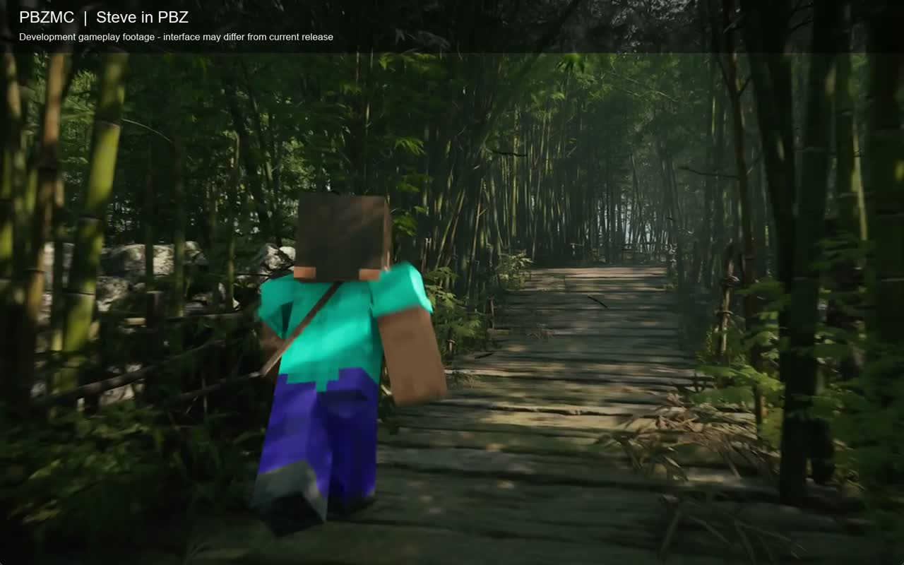

# PBZMC

在《影之刃零》（PBZ）的关卡里使用 Minecraft 风格的背包、装备、建造与红石玩法。史蒂夫外观与玩法模式独立，PBZ 原版武器仍走原生战斗逻辑。

[观看／下载演示视频](https://github.com/fjdsjd/pbz-mc/releases/download/v0.1.0-alpha.1/PBZMC-demo.mp4) · [下载模组](https://github.com/fjdsjd/pbz-mc/releases) · [安装教程](docs/INSTALLATION.md) · [按键说明](docs/CONTROLS.md)

演示为本项目开发期间的真实游戏录像，包含角色、剑盾、放拆方块、末影珍珠和背包预览。录像早于当前发行版，部分 UI 和初始装备已有更新。

## 安装

1. **退出游戏并备份存档。** 原生存档和模组数据需要一起保存，具体位置见[备份说明](docs/INSTALLATION.md#备份与恢复)。
2. 首次安装请选择以 `-win64.zip` 结尾的**标准包**。已有 PBZMC 资源可选同版本的 **`-win64-offline-cache.zip` 免下载包**。修复大存档读档问题需使用 **0.1.0-alpha.5 或更新版本**。已有压缩包可直接继续下一步。[GitHub 发行文件](https://github.com/fjdsjd/pbz-mc/releases) · [Nexus 文件页](https://www.nexusmods.com/phantombladezero/mods/374?tab=files) · [大陆网络下载说明](docs/INSTALLATION.md#中国大陆网络与下载失败)
3. 将压缩包内容解压到 PBZ 游戏根目录，也就是包含 `platform/steam/PBZ.exe` 的目录。解压后 `Launch-PBZMC.cmd` 应与 `platform` 文件夹并列。
4. 双击 **`Launch-PBZMC.cmd`**。标准包在首次缺少资源时下载并在本机转换。免下载版只校验本机已有资源。换电脑时，先把自己的 `PBZMC/cache/runtime-assets` 目录复制到游戏目录的相同位置。两种安装器都会先核验游戏版本、备份存档，然后安装并通过 Steam 启动。

标准包首次准备资源需要联网及额外磁盘空间。安装器会自行准备转换工具，下载中断后可保留缓存重试。公开免下载版需要与该版本资源配方相符的完整缓存；加入新物品的版本不能直接使用旧缓存。个人离线包包含已转换的配套资源，首次运行也不下载。[下载来源与重试方法](docs/INSTALLATION.md#中国大陆网络与下载失败)

**从 0.1.0-alpha.6 起，每次玩模组都使用 `Launch-PBZMC.cmd`。直接从 Steam 点“开始游戏”会进入原版。** 启动脚本只对本次进程开启模组，不改 Steam 的持久启动选项。正常退出或崩溃后无需运行卸载器，也不必重新下载资源。旧版升级后需运行一次新版 CMD，完成加载器替换。

**0.1.0-alpha.6.2**　[标准包](https://github.com/fjdsjd/pbz-mc/releases/download/v0.1.0-alpha.6.2/PBZMC-0.1.0-alpha.6.2-win64.zip) · [免下载包](https://github.com/fjdsjd/pbz-mc/releases/download/v0.1.0-alpha.6.2/PBZMC-0.1.0-alpha.6.2-win64-offline-cache.zip) · [标准包大陆备用](https://gh-proxy.com/https://github.com/fjdsjd/pbz-mc/releases/download/v0.1.0-alpha.6.2/PBZMC-0.1.0-alpha.6.2-win64.zip) · [免下载包大陆备用](https://gh-proxy.com/https://github.com/fjdsjd/pbz-mc/releases/download/v0.1.0-alpha.6.2/PBZMC-0.1.0-alpha.6.2-win64-offline-cache.zip) · [SHA-256](https://github.com/fjdsjd/pbz-mc/releases/download/v0.1.0-alpha.6.2/SHA256SUMS.txt)。

已有完整 alpha.6 资源缓存的玩家可以直接使用本版免下载包。

支持 Steam Windows x64 构建 26266538、26367565。较新的官方 UE 5.7 构建会在启动时自动定位接口。全部匹配即可游玩，匹配失败会显示游戏版本和具体错误，可据此提 issue。[版本兼容说明](docs/COMPATIBILITY.md)

## 当前玩法

- 常驻史蒂夫、MC 第一人称与 PBZ 原版视角、实时背包人物预览。
- 选中 PBZ 原生武器后可按 F6 开关自动完美格挡与闪避，默认关闭。H 可重看提示。
- 27 格背包、9 格快捷栏、副手、护甲、分类分页目录、垃圾槽与物品名称提示。PBZ 原生槽位作为引用物品进入同一个快捷栏。
- 多材质剑、矛、重锤、风弹、镐、铲、斧、弓与盾。MC 装备没有耐久消耗。PBZ 原生战斗与 MC 物品按当前选择切换。
- 红心、护甲、金心与效果显示，经验条映射 PBZ 体力。金苹果、附魔金苹果、图腾、末影珍珠、紫菘果、鞘翅及烟花。
- 背包目录提供生物刷怪蛋和刷怪笼。召唤的生物可受伤，具备攻击能力的物种会主动对付附近的 PBZ 敌人。[生物模型与动作](docs/MOB_MODELS.md)
- 提供饮用、喷溅、滞留药水与牛奶桶，可作用于自己、MC 生物和 PBZ 生物。原版生物攻击也能施加中毒、缓慢、漂浮等状态。用法与支持范围见[药水说明](docs/POTIONS.md)。
- 放置和挖掘模组方块、TNT、船、门、水与岩浆、活塞、粘性活塞、红石器件、粘液块、蜂蜜块与观察者。不能任意挖掘 PBZ 原地图。
- 火焰会熄灭、向可燃方块蔓延并引燃 TNT；岩浆随机引火，水能灭火。行为和性能边界见[火焰说明](docs/FIRE.md)。
- 按 **B → 建筑** 翻页取用 Minecraft 26.3 建筑页的 475 种方块和 195 种彩色建材。台阶可合并，楼梯会转角，栅栏、玻璃板和墙会随邻块连接。生存模式按方块硬度、工具种类与材质计算挖掘时间。
- `/gamemode creative` 与 `/gamemode survival`，创造模式具有飞行与伤害免疫。
- 支持脉冲、循环、连锁三种命令方块，右键编辑，接入红石和条件链。`/` 命令行支持 Tab 补全、历史记录、实体选择器、传送、伤害、物品、建筑、计分板与函数。MC 召唤物和 PBZ 角色共用实体接口；具体范围和明确报错的未接入项见[命令兼容表](docs/COMMANDS.md)。

**新存档初始快捷栏：** PBZ 武器引用、木剑、金苹果 ×1、附魔金苹果 ×1、末影珍珠、泥土、TNT、打火石、空格。盾牌在副手。PBZ 槽位来自实际原生装备，不生成额外武器。已有模组存档保留原有物品和布局。

进入玩法后会短暂显示操作提示，12 秒后自动隐藏，按 **H** 可提前关闭或再次查看。**遇到 PBZ 攀岩，请切换到影之刃主武器；马车战建议使用影之刃原版武器。**

背包、数量和建筑先在内存中提交，**只在 PBZ 原生保存入口保存时落盘**。退出前请正常保存；强退或在最近保存后继续建造，可能丢失后续改动。安装脚本的文件备份不等于替你在游戏里保存进度。

## 卸载、更新和故障

先退出游戏，再使用 `Backup-PBZMC.cmd` 备份。`Uninstall-PBZMC.cmd` 只删除安装记录中且内容未被修改的模组文件，保留原生存档、模组数据和备份。更新、恢复、与其他 UE4SS 模组共存的处理见[安装教程](docs/INSTALLATION.md)。

问题反馈：[GitHub Issues](https://github.com/fjdsjd/pbz-mc/issues)。请提供发行版本、游戏版本、复现步骤和相关日志片段；不要上传完整存档、账号信息或含个人路径的日志。

如果推进到第二章后读档只剩史蒂夫、背包和快捷栏都消失，请先保留当前进度。旧版可能读不下游戏展开后的存档 JSON；磁盘上约 128 KB 的文件也可能触发。请参照[大存档排查与备份](docs/INSTALLATION.md#大存档与读档失败)更新后重读原档。

## 源码与许可

源码公开，按 **PolyForm Noncommercial 1.0.0** 提供。该许可限制商业用途，因此本项目不能被当作 MIT 等允许任意商业使用的开源代码。复用的玩法基线为 [wukong-steve 0.11.0](https://github.com/nicedoctors/wukong-steve/tree/9f213556519dca4498fd46f02af6236ae121ecae)，保留作者声明；其余依赖遵循各自许可。见 [LICENSE](LICENSE)、[NOTICE](NOTICE) 和[构建说明](docs/BUILDING.md)。

Minecraft 原始贴图、模型、字体、音效以及 PBZ 游戏文件不包含在源码仓库或发行压缩包中，也不适用本项目源码许可。首次启动在玩家本机准备所需资源；请遵守原游戏的条款与 [Minecraft 使用规范](https://www.minecraft.net/en-us/usage-guidelines)。本模组不附带游戏本体或任何个人存档。

**非官方 Minecraft 产品，未经 Mojang 或 Microsoft 批准，亦与其无关联。非《影之刃零》官方产品。** Minecraft 属于 Mojang／Microsoft，《影之刃零》属于其权利人。
